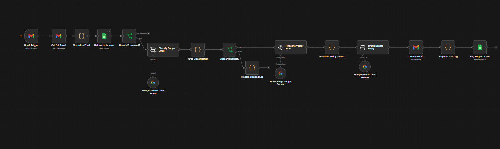
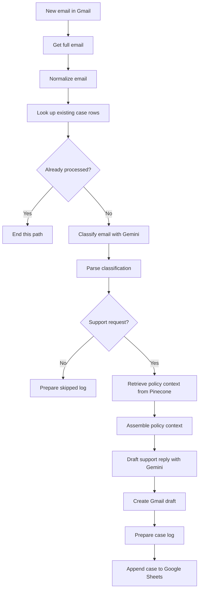
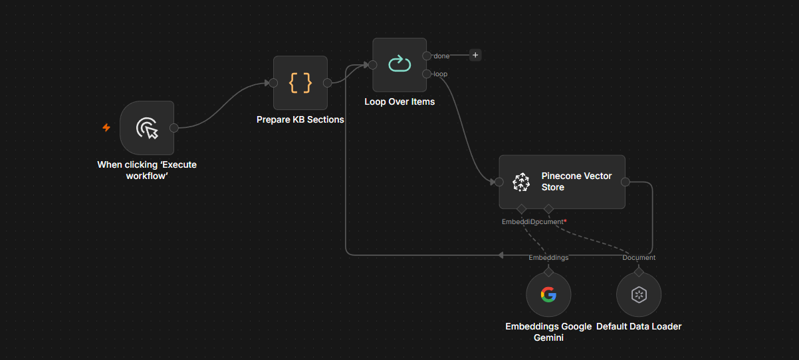

# Northstar — AI-Assisted Customer Support Automation

An n8n project that turns incoming customer emails into policy-informed Gmail drafts using Google Gemini, Pinecone, and Google Sheets.

I built this automation around a support scenario for **Northstar**. It brings together email intake, support-request classification, knowledge-base retrieval, reply drafting, and case logging. The workflow creates a draft in Gmail so a person can review the response before sending it.

**Stack:** n8n · Gmail · Google Gemini · Pinecone · Google Sheets · JavaScript Code nodes

## The problem

Answering support emails involves several repeated steps: reading the message, deciding whether it needs support, finding the relevant policy, writing a helpful reply, and recording what happened. These steps become harder to keep consistent as the inbox grows.

My project connects those steps in two workflows:

1. **Knowledge-base ingestion:** prepare Northstar's policy sections and store their embeddings in Pinecone.
2. **Support-email processing:** classify a new email, retrieve relevant policy context, create a Gmail draft, and append a support-case record to Google Sheets.

## Workflow at a glance



[Open the full-size workflow screenshot](docs/images/support-email-workflow.png).



The diagram summarizes the visible connections. In the screenshot, **Prepare Skipped Log** has no downstream storage node connected, while the support branch ends at **Log Support Case**.

## What I built

### 1. A knowledge-base ingestion workflow

Before the email workflow can retrieve useful context, the company policies need to be available in the vector store.



| Node | Role in the workflow |
| --- | --- |
| **When clicking ‘Execute workflow’** | Starts the ingestion workflow manually. |
| **Prepare KB Sections** | Uses a Code node to prepare the knowledge-base sections for ingestion. |
| **Loop Over Items** | Passes the prepared items through the ingestion loop. |
| **Default Data Loader** | Supplies document content to the vector-store operation. |
| **Embeddings Google Gemini** | Converts document text into numerical representations for semantic retrieval. |
| **Pinecone Vector Store** | Stores the embedded documents. Its output returns to the loop to continue processing. |

This gives the support workflow a separate source of company information to search when composing a reply. Policy preparation and incoming-email handling can be maintained independently.

The screenshot shows the ingestion structure; the complete policy text, chunking settings, metadata, and index configuration are inside the original workflow and are not included in these images.

### 2. Email intake and normalization

The main workflow starts with **Gmail Trigger**, followed by **Get Full Email**. Retrieving the message gives the later stages the email content they need to work with.

**Normalize Email** is a JavaScript Code node between the Gmail read operation and the case lookup. Its role is to prepare a consistent email representation for the next steps. The screenshot does not expose its code or exact output fields.

### 3. A processed-email check

**Get row(s) in sheet** reads from Google Sheets before **Already Processed?** decides whether the email should continue. The false branch leads to classification; the true branch ends in the visible workflow.

This is the project's duplicate-check stage: it is intended to avoid drafting another response for an email already represented in the case log. The exact lookup column and comparison expression need to be taken from the exported workflow.

### 4. AI classification and routing

**Classify Support Email** connects to a **Google Gemini Chat Model**. Its result goes through **Parse Classification**, a Code node, before reaching **Support Request?**.

These stages separate the model's classification from the routing decision:

- A support request continues to the policy-retrieval branch.
- A non-support message goes to **Prepare Skipped Log**.

The images show this support/non-support decision, but do not reveal the full classification prompt, response schema, or additional labels. No priority, sentiment, or confidence fields are assumed in this documentation.

### 5. Retrieval of relevant policy context

For support requests, **Pinecone Vector Store** is connected to **Embeddings Google Gemini**. This stage retrieves company knowledge related to the customer's question. **Assemble Policy Context** then prepares the retrieved information for the reply-generation stage.

This is the retrieval-augmented generation (**RAG**) part of the project: retrieve relevant reference material, then use that material while generating the response. It helps the draft address Northstar's policies rather than relying only on the language model's general knowledge.

The workflow uses Pinecone in the main execution path, with a separate context-assembly step before drafting. The screenshot does not show retrieval limits, similarity thresholds, or the embedding-model version.

### 6. Drafting a support reply

**Draft Support Reply** connects to a second **Google Gemini Chat Model**, labeled **Google Gemini Chat Model1**. It follows the assembled policy context in the flow and produces content for **Create a draft**.

The Gmail node is visibly configured as **create: draft**. The workflow therefore prepares a response in Gmail. A person reviews the message and decides when to send it. See [n8n's Gmail draft documentation](https://docs.n8n.io/integrations/builtin/app-nodes/n8n-nodes-base.gmail/draft-operations/) for the operation's configuration.

### 7. Logging the support case

After the draft is created, **Prepare Case Log** formats a record and **Log Support Case** appends it to Google Sheets.

This creates a place to track handled support emails and supports the earlier processed-email check. The actual sheet headers, stored values, and draft/message identifiers are not visible in the screenshot, so they are not presented as a verified schema here.

## Main workflow: node-by-node reference

| Order | Node | Purpose |
| --- | --- | --- |
| 1 | Gmail Trigger | Start processing an incoming email. |
| 2 | Get Full Email | Retrieve the email message. |
| 3 | Normalize Email | Prepare the email data for downstream steps. |
| 4 | Get row(s) in sheet | Look up existing case records. |
| 5 | Already Processed? | Route an already-recorded email away from further processing. |
| 6 | Classify Support Email | Use the connected Gemini chat model to classify the email. |
| 7 | Parse Classification | Parse the classification result for routing. |
| 8 | Support Request? | Choose the support or skipped path. |
| 9a | Prepare Skipped Log | Prepare a record for a non-support message; this visible branch ends here. |
| 9b | Pinecone Vector Store | Retrieve relevant company knowledge using the connected Gemini embeddings node. |
| 10 | Assemble Policy Context | Prepare retrieved policy content for drafting. |
| 11 | Draft Support Reply | Use the second Gemini chat model to generate reply content. |
| 12 | Create a draft | Save the response as a Gmail draft. |
| 13 | Prepare Case Log | Prepare the support-case record. |
| 14 | Log Support Case | Append the support-case record to Google Sheets. |

The connected Gemini chat and embedding nodes support these main-path nodes; they are shown below them in the workflow screenshot.

## Example: a customer asks about a return

The supplied Gmail example shows a customer asking whether an unopened item received **10 days ago** can still be returned.

The draft response:

- Recognizes that 10 days falls within the **14-calendar-day** return window described in the example.
- Explains that a change-of-mind return requires an unused, unopened item in its original packaging.
- Notes that original shipping charges are typically non-refundable for these returns.
- Explains that the team must receive and review the item before processing a refund.
- Invites the customer to confirm that they want to proceed.

These are the policy statements visible in this project's example draft. They are not a complete Northstar policy document or an independently verified statement of company terms.

Read the [sample customer email and draft reply](docs/DEMO.md). Personal identifiers have been generalized in that transcription.

## Tools and why I used them

| Tool | Responsibility |
| --- | --- |
| **n8n** | Connect the services and control the workflow branches. |
| **Gmail** | Receive/read customer messages and store reply drafts. |
| **Google Gemini chat models** | Classify the email and generate the draft response. |
| **Google Gemini embeddings** | Represent document and query text for semantic retrieval. |
| **Pinecone** | Store and retrieve embedded knowledge-base content. |
| **Google Sheets** | Look up existing case records and append support-case logs. |
| **JavaScript Code nodes** | Prepare KB sections, normalize emails, parse classification, assemble context, and prepare logs. |

## Repository contents

```text
.
├── README.md
├── PUBLISHING.md
├── .gitignore
├── .gitattributes
├── docs/
│   ├── DEMO.md
│   └── images/
│       ├── support-email-workflow.png
│       └── knowledge-base-ingestion.png
└── workflows/
    └── README.md
```

**Current release:** a documented project walkthrough based on the supplied workflow screenshots and Gmail draft example. Importable workflow JSON exports have not been supplied yet. The repository includes instructions for adding the original workflows; it does not contain a reconstructed or invented implementation.

## Setting up the automation from the original workflows

To reproduce the project, first add the real n8n exports using the [workflow export instructions](workflows/README.md). Then use this configuration sequence:

1. **Prepare your n8n instance.** Ensure it provides the Gmail, Google Sheets, Gemini, Pinecone, Code, IF, loop, and document-loader nodes shown above.
2. **Connect the accounts in n8n.** Configure Gmail and Google Sheets access, a Gemini credential, and a Pinecone credential. Select them in the relevant imported nodes.
3. **Configure the knowledge base.** Review the Northstar policy sections in **Prepare KB Sections** and the document mappings in **Default Data Loader**.
4. **Configure Pinecone.** Use the intended index and namespace consistently in both workflows. Match the index's vector dimensions to the configured embeddings and use compatible embedding settings for ingestion and retrieval. Check the [Pinecone Vector Store node documentation](https://docs.n8n.io/integrations/builtin/cluster-nodes/root-nodes/n8n-nodes-langchain.vectorstorepinecone/) when setting up its document operations.
5. **Configure the case sheet.** Use the headers expected by the original lookup and append mappings. Confirm that the lookup key matches the value written to identify processed emails.
6. **Review the AI and Code nodes.** Check the original prompts, parsed fields, branch expressions, and context mappings together. The classification output must match what the parser and IF node expect.
7. **Run ingestion first.** Execute the knowledge-base workflow and confirm that the intended documents are available in Pinecone.
8. **Test email processing.** Use a test inbox or test messages and review the Gmail draft and sheet record before enabling ongoing processing.

Exact model IDs, credentials, sheet mappings, prompts, Code-node implementations, and retrieval parameters should come from the original workflows, not from guesses based on the screenshots.

## Validation checklist

The images show the workflow design and one draft example. The checks below are suggested validation steps for the runnable project; they are not reported as tests already performed.

| Scenario | What to inspect |
| --- | --- |
| New support email | The support branch creates a relevant Gmail draft and a case row. |
| The same email is processed again | The existing case record is found and another draft is avoided. |
| Non-support email | The skipped path runs; verify separately whether skipped records should be stored. |
| Return question like the demo | The reply uses the supplied policy and explains the conditions accurately. |
| No relevant policy retrieved | Review the resulting behavior and define a fallback or human-review response if needed. |
| Classification is malformed | Verify how the parser handles the output and whether recovery is needed. |
| Draft succeeds but case logging fails | Check whether retrying can create a second draft; decide how recovery should work. |

## Design boundaries and next improvements

The visible workflow includes a duplicate-check stage, but its concurrency behavior and retry guarantees cannot be established from screenshots. Draft creation happens before case logging, which makes recovery after a logging failure a useful area to test.

Useful next improvements include storing skipped-message records, adding explicit error handling, defining behavior for missing policy context, and recording policy references alongside drafts. An order-system lookup or a refund-processing integration would be separate additions; neither is shown in this project.

## What this project demonstrates

I combined event-driven automation, AI classification, semantic retrieval, conditional routing, data preparation, and service integration into a customer-support workflow. The core design brings company knowledge into reply drafting while keeping a person involved at the point of sending the response.

For uploading this project and adding the remaining exports, see [PUBLISHING.md](PUBLISHING.md).
